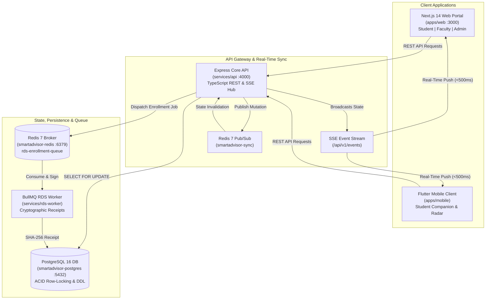

# SmartAdvisor NSU

[](https://github.com/DarkMonarch1/NSU_CSE327_SEC04_ITN/actions/workflows/ci-cd.yml)


> **North South University (NSU)**  
> **Department of Electrical & Computer Engineering (ECE)**  
> **Course:** CSE 327 (Section 04) — Software Engineering  
> **Supervisor:** Intisar Tahmeed Sir [ITN]

---

## 1. Executive Summary & Core Engineering Pillars

**SmartAdvisor NSU** is an autonomous, high-concurrency course advising and registration platform engineered for North South University. The system is designed to completely eliminate launch-minute seat contention, timetable clashes, prerequisite violations, and manual faculty approval bottlenecks during peak enrollment periods.

### Core Engineering Pillars

1. **Autonomous DAG Prerequisite & Senate Rule Engine**
   - Validates multi-tier curriculum prerequisite trees through an in-memory Directed Acyclic Graph (DAG).
   - Enforces North South University Academic Council policies automatically:
     - `RULE-4.2`: Senior Standing Credit Floor (strictly requires $\ge 100$ earned credits before allowing 400-level courses such as `CSE 425`).
     - `RULE-2.1`: Prerequisite Co-Registration Exemption (permits concurrent enrollment in theory and prerequisite lab for graduating seniors).
     - `RULE-6.3`: Consecutive Exam Load Rebalancer (detects and flags 3 consecutive final examinations within a 24-hour window).
     - `RULE-8.4`: Department Chair $+10$ Seat Override (authorizes emergency capacity expansion up to physical room fire-code safety ceilings).

2. **Zero Double-Booking via PostgreSQL 16 ACID Transactions**
   - Eliminates race conditions and overbooking across thousands of concurrent enrollment requests.
   - Implements strict PostgreSQL row-level pessimistic locking (`SELECT ... FOR UPDATE`) on target section records.
   - Dual-mode architecture seamlessly provides automatic in-memory locking fallbacks with identical concurrency semantics during CI/CD headless test runs.

3. **Sub-500ms Cross-Platform State Synchronization**
   - Instantaneous state dissemination across Web, Mobile, and Staff consoles via Server-Sent Events (`GET /api/v1/events`), backed by Redis 7 Pub/Sub channel `smartadvisor-sync`.
   - Client-side tab federation via browser `BroadcastChannel` and `localStorage` storage events ensures instant reactive updates in $\le 500\text{ ms}$.

4. **Headless NSU RDS Queue Execution**
   - Decoupled asynchronous background execution via BullMQ on `rds-enrollment-queue`.
   - Deterministic SHA-256 cryptographic verification tokens (`SHA256:...`) and receipt transaction numbers (`#RDS-TXN-2025-XXXXX`) generated upon atomic seat commitment.

---

## 2. System Architecture



---

## 3. Feature Breakdown by Platform & Role

### 🎓 Student Web Portal (`/student/dashboard`, `/student/schedule`)
- **Interactive Section Staging**: Stage, swap, or drop theory and lab sections with live seat counters and instantaneous visual feedback.
- **Real-Time Timetable Clash Detection**: Instant matrix analysis preventing conflicts across North South University standard day pairings (`ST`, `MW`, `RA`, and `Thu`).
- **Rule 4.2 Standing Floor Warnings**: Unlocks modal explanations and advisor routing whenever students below 100 credits attempt 400-level registrations.
- **Intelligent Full-Seat Alternatives**: Automatically surfaces open alternative sections for the same course code when a target section is filled.
- **Atomic Schedule Lock & Cryptographic Receipt**: Locks student schedule inside an ACID transaction and emits an official digital receipt with transaction ID (`#RDS-TXN-2025-XXXXX`) and cryptographic SHA-256 signature.

### 👩‍🏫 Faculty Web Portal (`/faculty/exceptions`, `/faculty/courses`, `/faculty/rules`)
- **6-Point Automated Rule Audit Checklist**: Automatically audits student CGPA, prerequisite clearance, degree credits, graduation horizon, seat availability, and financial clearance.
- **1-Click Decision Workflow**: Actionable `Approve`, `Reject`, or `Flag for In-Person Advising` buttons for pending exception cases (e.g., `#EX-2025-0841`).
- **Physical Room Capacity Expansion**: Allows authorized faculty advisors to expand capacity (`+1` to `+15` seats) within certified fire-code room limits (e.g., `LIB 602` max 55).
- **Senate Bypass Rule Toggles**: Live toggling of institutional academic council policies (`RULE-4.2`, `RULE-2.1`, `RULE-6.3`, `RULE-8.4`) with immediate effect across the scheduling engine.

### ⚙️ Admin Operations Portal (`/admin/health`, `/admin/escalations`)
- **Real-Time Telemetry & SLA Ceilings**: Tracks requests/sec, p95 latency against the 200 ms SLA ceiling, database connection pool utilization, and error rates.
- **Cluster Auto-Scaling Simulation**: Triggers `+2 Node` auto-scaling, immediately dropping latency from elevated levels ($>200\text{ ms}$) back to steady-state ($138\text{ ms}$).
- **SEV-1 Bottleneck Escalation Hub**: Live tracking of course demand deficits (e.g., `#ESC-9481` for `CSE 327` with 42 waitlisted students) broken down by student major.
- **Emergency Section Provisioning**: One-click provisioning of new course sections (e.g., `CSE 327 Sec 05` in `LIB 608`) to resolve waitlist deficits.
- **Classroom Demo Surge Simulator**: Built-in interactive simulator (`DemoHeader`) to inject 3,450 req/s traffic spikes, force section sell-outs (40/40), and restore state to baseline fixtures.

### 📱 Flutter Mobile Client (`apps/mobile`)
- **Student Home Dashboard**: At-a-glance academic standing, 96 completed credits progress bar, CGPA indicator, advising clearance status, and cart tokens.
- **Course Catalog & Details**: Full searchable course catalog with prerequisite indicators, faculty listings, time slots, room locations, and live seat badges.
- **Visual Timetable Builder**: Interactive weekly grid displaying enrolled and staged courses across Sunday through Thursday.
- **Petition & Exception Tracker**: Real-time status updates on submitted petitions (`PET-327-01` Approved, `PET-425-01` Pending Standing Review, `PET-361-02` Waitlisted).
- **Seat Drop Radar Alerts**: Push notifications and alert banners alerting students when seats open in previously filled high-demand sections.

---

## 4. Backend API & Worker Reference

### REST & Real-Time Endpoints (`services/api :4000`)

| Method | Endpoint | Request Payload | Description |
| :--- | :--- | :--- | :--- |
| `GET` | `/health` | _None_ | Service health check returning `{ status: "ok", service: "smartadvisor-api" }`. |
| `GET` | `/api/v1/bootstrap` | _None_ | Hydrates the entire portal state (student profile, sections, exceptions, rules, metrics, audit log). |
| `GET` | `/api/v1/events` | _None_ | Server-Sent Events (SSE) stream for sub-500ms real-time state broadcast and cross-platform sync. |
| `POST` | `/api/v1/student/cart/stage` | `{ "sectionId": "CSE327-01" }` | Stages a section into the student cart; validates Rule 4.2 credit floors and seat availability. |
| `DELETE` | `/api/v1/student/cart/:sectionId` | _None_ | Removes a staged course section from student cart and appends an audit log entry. |
| `POST` | `/api/v1/student/enroll/confirm` | _None_ | Atomically locks schedule, increments enrolled counts, generates SHA-256 digital receipt and `#RDS-TXN-...`. |
| `POST` | `/api/v1/faculty/exceptions/decision` | `{ "caseId": "EX-0841", "action": "approve" }` | Processes exception decision (`approve`, `reject`, `flag`); updates section capacity and records audit log. |
| `POST` | `/api/v1/faculty/sections/expand-capacity` | `{ "sectionId": "CSE327-04", "delta": 5 }` | Expands section seat capacity by `delta` up to physical room safety limits. |
| `POST` | `/api/v1/faculty/rules/toggle` | `{ "ruleId": "rule-4-2" }` | Toggles an academic senate bypass rule on/off and broadcasts updated rule state. |
| `POST` | `/api/v1/admin/scale` | _None_ | Simulates cluster auto-scaling (`+2 Nodes`), drops p95 latency to 138 ms, and records scaling event. |
| `POST` | `/api/v1/admin/acknowledge` | _None_ | Acknowledges active SEV-1 surge spike incident, resetting `surgeSpikeActive` flag to false. |
| `POST` | `/api/v1/admin/sections/emergency` | `{ "courseCode": "CSE 327" }` | Provisions an emergency Section 05 (+40 seats), mitigating high-priority escalation queues. |
| `POST` | `/api/v1/admin/courses/add-seats` | `{ "courseCode": "CSE 327", "count": 10 }` | Adds seats across all sections of a course and marks matching escalation resolved. |
| `POST` | `/api/v1/demo/surge` | _None_ | Simulates a 3,450 req/s high-concurrency surge spike, triggering an active SEV-1 incident state. |
| `POST` | `/api/v1/demo/section-full` | `{ "sectionId": "CSE327-01" }` | Simulates real-time seat exhaustion on a section (`enrolled = capacity`). |
| `POST` | `/api/v1/demo/reset` | _None_ | Restores entire dual-mode backend store to pristine initial state fixtures. |

### BullMQ Background Worker (`services/rds-worker`)

- **Queue Name**: `rds-enrollment-queue`
- **Job Payload**:
  ```json
  {
    "studentId": "2412159042",
    "courseCode": "CSE 327",
    "section": 1,
    "semester": "Spring 2025"
  }
  ```
- **Job Result & Cryptographic Token**:
  ```json
  {
    "success": true,
    "studentId": "2412159042",
    "courseCode": "CSE 327",
    "enrolledAt": "2026-11-18T07:19:34.000Z",
    "message": "Successfully processed enrollment for 2412159042 in CSE 327 Sec 1",
    "transactionId": "#RDS-TXN-A3B9F10C",
    "digitalSignature": "SHA256:e3b0c44298fc1c149afbf4c8996fb92427ae41e4649b934ca495991b7852b855"
  }
  ```

---

## 5. Monorepo Directory Structure

```text
NSU_CSE327_SEC04_ITN/
├── .github/
│   └── workflows/
│       └── ci-cd.yml             # 4-job parallel CI/CD pipeline (backend, web, mobile, docker)
├── apps/
│   ├── web/                      # Next.js 14 App Router + TypeScript + Tailwind CSS portal
│   │   ├── app/                  # Route handlers: /student, /faculty, /admin, /login
│   │   ├── src/
│   │   │   ├── components/       # Portal UI components & shared modal system
│   │   │   ├── store/            # smartAdvisorStore.tsx (Live API + SSE + Broadcast sync)
│   │   │   └── types/            # TypeScript domain interfaces
│   │   └── package.json
│   └── mobile/                   # Flutter cross-platform mobile client
│       ├── lib/
│       │   ├── models/           # Data models (Course, Petition, Radar Alert)
│       │   ├── state/            # app_state.dart (ChangeNotifier state management)
│       │   ├── screens/          # Dashboard, Catalog, Timetable, Petitions
│       │   └── widgets/          # Shared widgets & status badges
│       └── pubspec.yaml
├── services/
│   ├── api/                      # Core Express + TypeScript REST API (:4000)
│   │   ├── src/
│   │   │   ├── db/               # PostgreSQL 16 schema.sql & connection pool
│   │   │   ├── events/           # sseHub.ts (Server-Sent Events broadcaster)
│   │   │   ├── routes/           # bootstrap, student, faculty, admin, demo routers
│   │   │   ├── services/         # ruleValidator.ts (Prerequisite, clash, Rule 4.2 engine)
│   │   │   ├── store/            # backendStore.ts (ACID dual-mode in-memory & SQL store)
│   │   │   └── app.ts            # Express application entrypoint
│   │   ├── Dockerfile
│   │   └── package.json
│   └── rds-worker/               # BullMQ + Redis background queue worker
│       ├── src/
│       │   ├── worker.ts         # SHA-256 receipt generation & queue processor
│       │   └── index.ts          # Worker runtime process
│       └── package.json
├── infrastructure/
│   └── docker-compose.yml        # PostgreSQL 16, Redis 7, and API container orchestration
├── PROJECT_OVERVIEW.md           # System documentation & architectural roadmap
└── README.md                     # Monorepo technical documentation
```

---

## 6. Team Roster & Git Branch Ownership

Every team member develops features on their designated branch and opens pull requests targeting `main`. All pull requests must pass the complete 4-job CI/CD pipeline before merging.

| Team Member | Role | Assigned Branch |
| :--- | :--- | :--- |
| **Jihanur Rahman** | Monorepo Core & CI/CD, Full-Stack | [`Jihanur-Rahman`](https://github.com/DarkMonarch1/NSU_CSE327_SEC04_ITN/tree/Jihanur-Rahman) |
| **MD. Sarafat Hossin Talukder Asif** | Web Platform (Next.js) & Mobile Platform (Flutter) | [`MD.-Sarafat-Hossin-Talukder-Asif`](https://github.com/DarkMonarch1/NSU_CSE327_SEC04_ITN/tree/MD.-Sarafat-Hossin-Talukder-Asif) |
| **Md Junayed Uddin** | Backend & RDS Integration | [`Md-Junayed-Uddin`](https://github.com/DarkMonarch1/NSU_CSE327_SEC04_ITN/tree/Md-Junayed-Uddin) |
| **Sakib Uddin Mahamud** | Deployment & Cybersecurity | [`Sakib-Uddin-Mahamud`](https://github.com/DarkMonarch1/NSU_CSE327_SEC04_ITN/tree/Sakib-Uddin-Mahamud) |

---

## 7. Local Quickstart Guide

### Prerequisites
- Node.js 20.x LTS & npm 10+
- Flutter SDK (Channel `stable` $\ge 3.24$)
- Docker Engine & Docker Compose v2+

### Step-by-Step Setup

#### 1. Infrastructure (PostgreSQL 16 & Redis 7)
```bash
docker compose -f infrastructure/docker-compose.yml up -d
```
- PostgreSQL 16: `localhost:5432` (`user: smartadvisor`, `db: smartadvisor_db`)
- Redis 7: `localhost:6379`

#### 2. Backend Core API (`services/api`)
```bash
cd services/api
npm install
npm run typecheck
npm test
npm start
```
- API Endpoint: `http://localhost:4000`
- Health Probe: `http://localhost:4000/health`

#### 3. RDS Background Worker (`services/rds-worker`)
```bash
cd services/rds-worker
npm install
npm run typecheck
npm test
npm start
```

#### 4. Web Client (`apps/web`)
```bash
cd apps/web
npm install
npm run lint
npm run build
npm run dev
```
- Web Portal: `http://localhost:3000`

#### 5. Mobile Client (`apps/mobile`)
```bash
cd apps/mobile
flutter pub get
flutter analyze --no-fatal-infos
flutter test
flutter run
```

---

## 8. CI/CD Pipeline Verification

The repository enforces a 4-job parallel CI/CD pipeline in [`.github/workflows/ci-cd.yml`](.github/workflows/ci-cd.yml) on all pull requests and pushes to `main`:

```bash
# 1. Backend CI (services/api & services/rds-worker)
(cd services/api && npm run typecheck && npm test)
(cd services/rds-worker && npm run typecheck && npm test)

# 2. Web App CI (apps/web)
(cd apps/web && npm run lint && npm run build)

# 3. Mobile App CI (apps/mobile)
(cd apps/mobile && flutter analyze --no-fatal-infos && flutter test)

# 4. Docker Smoke Test (infrastructure)
docker compose -f infrastructure/docker-compose.yml config
docker build -t smartadvisor-api:smoke -f services/api/Dockerfile services/api
```
